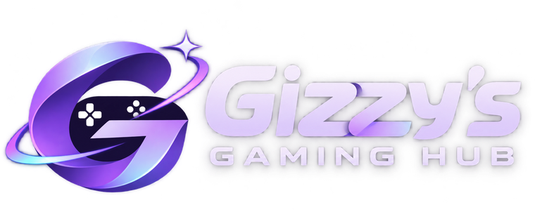

# Gizzy's Gaming Hub



A game hub for macOS that plays **your own Nintendo Switch and Switch 2 games natively on Apple silicon**.
It's a front end for the open-source [nxnative](https://github.com/seedds/nxnative) engine (MIT): the game's own
code runs directly on the Apple chip, and its graphics are rebuilt on Metal. It is not an emulator.

Extras: a console-style library you can drive with a controller, a launch intro, a quick menu
(L3 + R3), instant replay, save snapshots, Discord status, a Performance Doctor, a storage manager and a Twitch TV
with chat.

> **No games, keys or Nintendo files are included.** You need your own console keys (`prod.keys`) and your own
> game dumps. Only play games you own.

## Download and install

1. Download the latest **`GizzysGamingHub-<version>.dmg`** from [Releases](../../releases).
2. Open it and drag **Gizzy's Gaming Hub** onto **Applications**.
3. **First launch:** right-click the app › **Open** › **Open**. The app isn't notarized by Apple (it's a free hobby
   project), so macOS asks once. If it's still blocked: **System Settings › Privacy & Security › Open Anyway**.
4. Install **Xcode** from the Mac App Store and open it once, and install **[Homebrew](https://brew.sh)**.
5. In the hub's setup window, click **Run Setup**. It installs the Metal toolchain, zstd and glslang, a Python
   environment with the engine's packages, and .NET. That takes about 10–20 minutes the first time.
6. **Settings › Keys**: import your own `prod.keys`.
7. **Add Game** › pick your `.nsp` / `.xci` / `.nup` › open it › **Prepare for Mac** › **Play**.

### Twitch TV

The TV uses your own free Twitch developer key: create an application at
[dev.twitch.tv/console](https://dev.twitch.tv/console) and paste its Client ID in **Settings › Smart TV**.

### Requirements

- Apple silicon Mac (M1 or later). Intel Macs can't run games natively.
- macOS 13 or later.
- Xcode (free, Mac App Store) and Homebrew.
- Disk space: the tools take about 3 GB, and each prepared game 10–40 GB. The first preparation of a large game can take
  an hour or two and keeps the Mac busy.

### Which games work?

Whatever nxnative supports: see its [tested games list](Engines/nxnative/dm/games/README.md). Games without a tested
profile get a provisional build that may not start.

## Building from source

```
./build.sh --open      # builds build/Gizzy's Gaming Hub.app and opens it
./release.sh           # the release app + DMG in dist/
```

Developer notes: [docs/DEVELOPING.md](docs/DEVELOPING.md).

## Credits and licences

- **nxnative** © 2026 seedds, MIT licence: [Engines/nxnative/LICENSE](Engines/nxnative/LICENSE). The local changes
  are listed in [Engines/nxnative/UPSTREAM.txt](Engines/nxnative/UPSTREAM.txt).
- The other third-party parts and their licences: [NOTICE.md](NOTICE.md).
- Not affiliated with Nintendo, any game publisher, Twitch or Discord.
